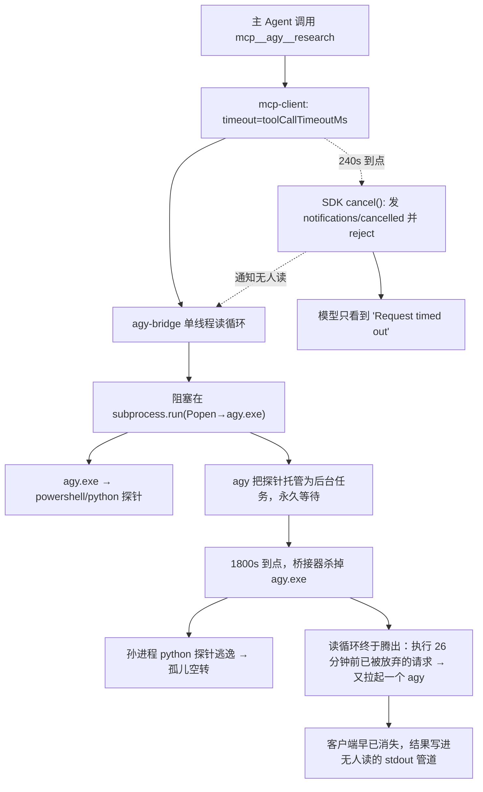

# 计划：agy-bridge 长任务断连与孤儿进程治理

> 落盘位置说明：本方案的对象是 `D:\Users\dsh-local-plugins`（DSH 本地插件库）内的 `@local/agy-bridge`
> 插件与其宿主 DSH，故计划随目标插件落盘于 `agy-bridge/plans/`，不进 `language_projects` 父仓
> `docs/`（该仓只收 `language_projects` 自身文档）。
> 取证日期：2026-10-18；环境：DSH 0.2.0-rc.2 / agy 1.4.2 / Node v24.10.0 / Windows 11。

---

## 一、问题陈述

DSH 主 Agent 经 stdio MCP 调用 `mcp__agy__research` 委托 agy 做宽面只读调研时，**任何超过客户端
工具调用上限的任务必然「客户端报超时、服务端继续跑」**，并在 Windows 上留下跨三层的孤儿进程
（`node → python → agy.exe → powershell/python`）。直接后果：前端长时间挂起、单核长时间满载、
主 Agent 拿到的是无上下文的 `Error: Request timed out`（拿不到 agy 的任何进度与失败原因），
而且要等 20 分钟以上。

范围边界：只治理「长任务委托」这一条链路。不改变 agy 的只读定位，不引入写权限，不改动
`subagent` / `argo` / `aoci` 等其它通道。

---

## 二、需求确认（来自用户原判定清单）

1. 超时契约脱节（客户端 240s vs 服务端 3600s）；
2. 进程生命周期失控（超时后子进程树不回收）；
3. 黑盒阻塞无心跳（执行期完全静默）；
4. 子 Agent 探针脚本缺乏性能防御（`Path.rglob` 裸扫全盘）。

以下比选与任务规划按此四条展开，但**先按取证结果修正其中两处的技术归因**（见第三节）。

---

## 三、取证结论（以本机证据为准）

### 3.1 四处需要修正的判定

| # | 原判定 | 取证结论 | 证据 |
| :-- | :--- | :--- | :--- |
| 1 | 「DSH 硬编码 `DEFAULT_TOOL_CALL_TIMEOUT_MS = 240000`」 | **不成立。**DRSH 的硬编码默认值是 **60 000 ms**，且该值**本来就是可配置的**（每服务器 `toolCallTimeoutMs`）。240 000 是**本项目自己在 profile 里配的值**，与客户端重试无关 | `@deepseek-ai/dsh-mcp-client/lib/index.js:765`（`6e4`）、`:787`/`:796`（schema 默认）、`README.zh.md:61`；`git diff agy-bridge` 显示三处 `toolCallTimeoutMs: 240000 → 3700000`（未提交） |
| 2 | 「DSH 判定超时后没有向下发送取消信号」 | **不成立（客户端确实发了）。**MCP SDK 在超时路径上会发出 `notifications/cancelled{requestId, reason}`。真正的问题在**服务端收不到也不处理**：桥接器丢弃一切 `notifications/*`，且此刻它的读循环正阻塞在 `subprocess.run` 里 | `@modelcontextprotocol/client/dist/src-D_zzAWoS.mjs:6096-6113`；`agy_bridge_server.py:508-511`（丢弃通知）、`:133`（阻塞读循环） |
| 3 | 「没有杀掉底层子进程树」 | **成立，且比描述更严重：链路三层各自都只杀直接子进程**（见 3.2） | `stdio.mjs:175-199`、`bin/launch.mjs:56-67`、`agy_bridge_server.py:133-150` |
| 4 | 「任何超过 4 分钟的深度任务挂在 MCP 工具下必死」 | **机制不同。**把 `toolCallTimeoutMs` 放大后，同步 MCP 调用**可以**跑 8 分钟以上（轮次 3 已证 agy 本身跑完只需 496s）。真正致命的是**桥接器单线程串行 + 不处理取消**：一个超时调用会**毒化整条桥**，后续调用排在它后面根本读不到，且旧请求被延迟执行 | 见 3.3 时间线（17:45:51 的第二次调用在 18:11:49 才真正被执行） |

### 3.2 三层「只杀直接子进程」的确证

```
DSH Host ──spawn──> node bin/launch.mjs ──spawn──> python agy_bridge_server.py ──Popen──> agy.exe ──> powershell / python(探针)
                        ①                        ②                            ③
```

| 层 | 回收代码 | 实际回收范围 | 证据 |
| :-- | :--- | :--- | :--- |
| ① SDK stdio transport | `close()` → `kill('SIGTERM'\|'SIGKILL')` | 只杀 **node 启动器**；且 `close()` 只在插件卸载/HMR 时调用，**工具调用超时不会触发** | `@modelcontextprotocol/client/dist/stdio.mjs:175-199`；`dsh-mcp-client/lib/index.js` 全文无超时分支 |
| ② `launch.mjs` | `process.on('SIGINT'/'SIGTERM')` → `child.kill()` | Windows 下 `TerminateProcess` 不会触发 Node 的信号处理器，**等于没有** | `bin/launch.mjs:56-67` |
| ③ 桥接器 | `subprocess.run(..., timeout=)` | 只杀 **`agy.exe` 本身**，孙进程（`powershell`、`python check_ptrs.py`）逃逸 | `agy_bridge_server.py:133-150` |

**对比证据（说明"正确做法"在本机已有实现）**：DSH 宿主自己的子进程层已经用 **kill-on-close 的
Windows Job Object** 实现连坐回收，并用 `waitForExit()` 独立证明 Job 已空
（`@deepseek-ai/dsh-subprocess-local/src/windows-job.ts`；`README.zh.md:28,86`）。
即：**孤儿问题在宿主侧早已解决，只是 Python 桥接器没用它、也用不到它。**

### 3.3 完整时间线（秒级证据，来自会话日志与 agy brain 目录）

对 `~/.dsh/sessions/--D-Users-language_projects--/session-9ed97212-…/session.v4.jsonl.zstd`
（428 个 zstd 帧、3.49 MB 明文）与 `~/.gemini/antigravity-cli/brain/*` 交叉比对：

| 时刻（本地） | 事件 | 证据 |
| :--- | :--- | :--- |
| 17:41:27 | 用户发出「请使用 agy 帮我调研一下当前项目的架构」 | 会话日志 `request/header` |
| 17:41:42 | 第 1 次 `mcp__agy__research` 下发（6 大模块长 prompt） | 会话日志 |
| 17:41:47 | 桥接器真正拉起 agy，会话 `b049d46a…` | `brain/b049d46a-a4a1-42e9-85b8-f5b9e0963b49/`（首条 `<USER_REQUEST>` 即该长 prompt） |
| **17:45:42** | **客户端满 240 s 抛 `Error: Request timed out`** | 会话日志 `tool/result` `"Error: Request timed out"`，`time=1792230342431` |
| 17:45:51 | 主模型反省后第 2 次调用（精简为「只读 4 个核心文件 + 8 分钟」） | 会话日志 `assistant/message` |
| 17:45:43–17:47:27 | **第 1 个 agy 在客户端早已放弃后继续跑到 step 61** | `brain/b049d46a/.system_generated/steps/37..61/output.txt` |
| **17:47:35** | **agy 写出探针脚本 `%TEMP%\check_ptrs.py`（`root.rglob("CLAUDE.md")` 裸扫全盘）** | 该文件存在，446 B，`LastWriteTime=2026-10-17 17:47:35`；正文含 `Path(r"D:\Users\language_projects")` + `root.rglob("CLAUDE.md")` |
| 17:47:38 | agy 把该脚本托管为后台任务 `task-63`，日志 **0 字节**，此后永久等待 | `brain/b049d46a/.system_generated/tasks/task-63.log`（0 B） |
| **17:49:51** | **第 2 次调用同样满 240 s 抛 `Request timed out`——服务端全程零反应** | 会话日志 `tool/result`，`time=1792230591539` |
| 17:50:29 | 主模型的 agy CLI 冒烟测试（`只回答两个字：收到`），与桥接无关 | `brain/a08f6985-…` 首条 `<USER_REQUEST>` |
| **17:50:56 → 17:59:12** | **轮次 3：改走 CLI 后台作业成功产出报告（496 s = 8 分 16 秒，与用户观察一致）** | `brain/c78931fd-…`（mtime 17:50:56→17:59:12） |
| 18:04:10 | 主 Agent 复核完毕，交付报告（用户感知总时长 ≈ 22.5 分钟） | 会话日志 |
| **18:11:47** | 桥接器 `subprocess.run(timeout=1800)` 对第 1 个 agy 到期 → `TerminateProcess(agy.exe)`；孙进程 `python check_ptrs.py` **成为孤儿继续单核空转** | `17:41:47 + 1800s` |
| **18:11:49** | **桥接器这才读出 17:45:51 那次已被放弃的请求，又拉起第 2 个 agy 跑同一份精简 prompt** | `brain/3a32a8a4-…`（创建于 18:11:49，首条 `<USER_REQUEST>` 正是 17:45:51 的精简 prompt） |

**这条 18:11:49 的记录是本方案最关键的新发现**：它把「单线程阻塞」「延迟执行已放弃请求」「客户端
超时后服务端继续产生副作用」三件事同时钉死，也解释了为何 `check_ptrs.py` 能从 17:47:35 一直空转
到 18:10 之后（约 23 分钟 ≈ 用户观察到的「100% 满载 20 多分钟」）。

### 3.4 三条「本来可以走、但走不通」的路（避免重复踩坑）

| 设想 | 结论 | 证据 |
| :--- | :--- | :--- |
| 用 MCP `notifications/progress` 做心跳 | **在本版 DSH 上结构性不可达**：DSH 从不传 `onprogress`，SDK 因此**不会挂 `progressToken`**；按规范服务端不应在无 token 时发进度。日志通知同理无人处理 | `dsh-mcp-client/lib/index.js:139-147`（只有 `signal`/`timeout`）；SDK `src-D_zzAWoS.mjs:6084-6093` |
| 用标准 MCP **Tasks**（`execution.taskSupport`）做长任务 | **被 DSH 明确拒绝**：声明 `taskSupport === "required"` 的工具直接注册失败 | `dsh-mcp-client/lib/index.js:227-229` |
| 靠 `dsh-tool-call-timeout-policy` 统一兜底 | **不作用于 MCP 工具**：该策略只给声明了 `ToolDefinition.timeoutMs` 的工具设限，mcp-client 注册的定义里没有这个字段 | `dsh-tool-call-timeout-policy/lib/index.js:123-124`；mcp-client 的 `createMcpToolDefinition` 返回对象无 `timeoutMs` |

### 3.5 一条现成可用的正向能力：`agy --output-format stream-json`

`agy --help` 显示 stream-json 与 `-p`（print 模式）兼容。实测（2026-10-18，本机 agy 1.4.2）：

```text
+  5809ms  event=init        （含 conversation_id、cwd、tools[]）
+  5862ms  step_update step=0 state=DONE type=user_input
+ 18530ms  step_update step=2 state=ACTIVE type=tool
+ 50545ms  step_update step=5 state=ACTIVE type=agent_response delta="已针对读取"
+ 51433ms  step_update step=5 state=DONE   type=agent_response
+ 51433ms  result status=SUCCESS turns=1 dur=45.6
+ 52813ms  [exit] code=0
```

事件是**边跑边吐**的（+5.8 s 就有 `init`，+18.5 s 的 `tool` 步在进程仍在运行时到达），不是结束
后一次性输出。另外 `agy --help` 还提供 `--conversation <id>`（续跑）、`--print-timeout`、`--log-file`。

**结论：不依赖 MCP 进度协议也能做出真实心跳**（把 stream-json 事件解析成 `step_index / step_type /
elapsed / tokens` 进度），这是原方案 B.3 的正确替代实现。

### 3.6 「不让人点 Proceed」的处理（已定案）

本次探针跑 `--sandbox --mode plan` 时，agy 在 **plan 模式**下把回合结束在「待确认事项：请点击
Proceed 或回复确认」上——**它停下来等人批准，而 `-p` 非交互调用没有人能点**，回合就此结束。

但这不是必然：事故里**成功那一次（brain `c78931fd`，496 s 跑完）同样用 `--mode plan`**，区别在于
它的 prompt 明确写了「报告直接作为你的最终回答输出（不要把报告写进文件）」；而本次冒烟探针的
prompt 只是「读取前 3 行」，agy 于是去写计划文档、等确认。结论：**这是提示词脚手架问题，不是模式
的硬缺陷**。处理分三道保险，顺序固定：

1. **守卫段强制声明非交互**（T8）：每次调用注入的守卫段明确写「本调用为 `-p` 非交互 print，无人
   可点击 Proceed；必须在同一回合内直接产出最终交付物，禁止生成待确认的计划文档」；
2. **plan-and-wait 自动续跑**（T8b）：状态机识别该终态（`status=SUCCESS` 但响应命中「待确认 /
   Proceed / 请审阅」特征，且 `num_turns` 远低于同类任务基线）→ 用 `agy --conversation <id>` 自动
   续跑一次（**上限 1 次**，防死循环），把「人点 Proceed」换成「机器续跑」。有了作业模型，这一跳
   不再受 240 s 客户端上限约束；
3. **换模式的 A/B 标定（仅在前两条仍不达标时启动）**：候选是 `--mode auto` + `--sandbox`（只读由
   沙箱承担）。**切换前必须先过负向写盘测试**：故意要求 agy「把结果写进 `.\_probe_write.md`」，
   断言该文件不存在。只读红线不凭猜测调整。

### 3.7 无法独立复核的部分

- 用户提到的 PID `46272`、以及「Step 62 / 184 步」的原始计数：`b049d46a` 的 steps 目录只到 61/63，
  进程号与步数未留存，**不作为本方案的判据**；
- 「CPU 100%」的具体百分比：本轮只确认了**孤儿探针脚本的真实存在与存活窗口**（17:47:35→18:11:47
  之后），未做 CPU 采样回放。

---

## 四、根因模型



一句话根因：**客户端的超时是「放弃等待」，桥接器的执行是「同步阻塞且不可取消」，两者之间没有
任何一条能把"别做了"送达的通道**；而 Windows 上三层进程各自只杀直接子进程，把这些「没人要的
工作」留在了机器上。

---

## 五、方案比选

### 方案 A：DSH 客户端层拦截与配置解耦

| 子项 | 机制 | 评价 |
| :--- | :--- | :--- |
| A1 每工具超时可覆写 | `mcp-client(config.toolCallTimeoutMs)` | **已经存在，无需改造 DSH**。当前 profile 已配 `3700000`（未提交）。成本≈0，收益：让桥接器成为权威超时，模型能看到带 `durationS` 与 agy stderr 的失败原因。**但这只是拆掉保险丝**：桥接器此刻仍会留孤儿、仍会延迟执行废弃请求 |
| A2 超时即回收 server 世代 | 扩展 DSH：超时时 `dispose` 该 server 的 generation（transport `close()`） | 可行但**只能整桥一锤子**（会连带杀掉同 server 其它在途调用），且对「已重试的第二次调用」无效；需要 patch 第三方装机产物（升级即丢）。有先例可循：`patches/apply-dsh-atomic-write-fallback.mjs` 的「标记 + 形状探针 + 备份 + 可回滚」模式 |

**结论：A1 保留（已完成）；A2 降为 P3 备选，不作为主路径。**

### 方案 B：重构 agy-bridge（服务端演进）

| 子项 | 机制 | 复杂度 | 侵入度 | 评价 |
| :--- | :--- | :--- | :--- | :--- |
| B1 作业句柄模式 | `research_submit` → `{job_id}`；`research_status` / `research_cancel` / `research_result` | 中 | 低（自家代码） | **必做。**唯一能真正击穿客户端超时的服务端手段：每次 `tools/call` 都在毫秒级返回 |
| B2 Windows Job Object 连坐 | `CreateJobObject` + `KILL_ON_JOB_CLOSE` + `AssignProcessToJobObject`，在 spawn 前建好 Job | 中 | 低（`ctypes`，零第三方依赖可保持） | **必做。**比原设想更强：可同时设 `ActiveProcessLimit` 与 `PerJobUserTimeLimit`，**直接对症 rglob 灾难**（沙箱只拦写、拦不住 CPU） |
| B3 进度心跳（原设计：MCP 通知） | 发 `notifications/progress` | 低 | 低 | **在本版 DSH 下不可达（3.4）**，改为 stream-json 解析 + `status` 回报 |
| B3′ 提示词注入守卫 | 每次自动追加「用 `git ls-files`、禁止裸 `rglob`、限深、限时」 | 低 | 低 | **必做，但只是"劝"**：3.3 的探针脚本本身是只读的，沙箱拦不住它。必须与 B2 的 CPU 上限/看门狗成对出现 |
| B4 取消语义 | 常驻读线程 + 处理 `notifications/cancelled` → kill job | 中 | 低 | **必做。**这是把「客户端超时」变成「服务端立刻收手」的第一道闸 |
| B5 并发与背压 | 同时最多 1 个 agy run，其余排队；`task-63` 类后台任务加无进度看门狗 | 低 | 低 | 建议并入 B1 |

### 方案 C：降级指引与调用路由规范

成本≈0，收益高（直接消灭命中概率），但**依赖模型自觉**。应当写成可执行的路由表 + 封装脚本，
而不是一句劝告。**必做（P0/P4）。**

### 方案 D（新增推荐）：宿主侧作业化

把 agy 跑成 **DSH 原生后台作业**：由宿主侧插件作为 `ctx.jobs` 生产者注册工作，产出走 job 的有界环，
结算时由 `dsh-tool-jobs` 投递**会话内通知（无需轮询）**。

- **优点**：超时层**根本不存在**（不再有 tool call 长挂）；完成即通知；进程 containment 与产出
  回收**直接复用宿主已实现的 Windows kill-on-close Job 与 spill 机制**；结果交付有界，不灌爆主上下文。
- **代价**：需要一个 TS 宿主插件（与 Python 桥能力重叠），agy 事件解析要在 TS 侧重写一遍
  （或由 Python 桥暴露一个"干跑"子命令复用）。
- **证据**：`@deepseek-ai/dsh-jobs/README.zh.md:12,32,51`（结算即会话内通知、`<kind>-N` id、有界环）、
  `@deepseek-ai/dsh-subprocess-local/README.zh.md:28,86,97`（Windows kill-on-close Job、`waitForExit` 证明清空、spill 恢复完整流）。

### 推荐组合（分层，先止血再根治）

```text
P0 路由止血（配置/规范，分钟级）      → 让重型任务不再命中同步 MCP 通道
P1 桥接器加固（B4+B2+B1+stream-json+B3′） → 同步通道变「可取消、可观测、连坐回收、结果有界」
P2 宿主侧作业化（方案 D，目标态）      → 长任务彻底脱离工具调用超时层
P3 视需要 patch 宿主（A2）            → 仅当 P1 落地后仍观察到底层泄漏才做
```

选择 P0→P1→P2 的理由：P1 是**最低成本的同时消除「孤儿」与「延迟执行废弃请求」**（这两个是真正
有副作用的缺陷，必须在 P2 之前或同时压住）；P2 是**问题类别消失**，而不是把参数调大。

---

## 六、风险与回归面

1. **Job Object 归属**：Job 必须只装 `agy.exe` 子树，**不能把桥接器自身装进去**（否则桥被关闭时
   连坐自身）；`PerJobUserTimeLimit` 打的是**整个 Job 的累计 CPU 时间**，取值需实测（建议先给
   20 分钟 CPU 上限，观察真实宽面调研的用量）。
2. **取消后的状态一致性**：`research_cancel` 必须做到「进程树归零」才允许把 job 标记为 `cancelled`，
   否则模型会以为已经停干净（需要 `QueryInformationJobObject` 的 `ActiveProcesses` 归零证明）。
3. **结果交付与「零写盘」不变式冲突**：作业模型天然需要保留中间/最终产物。是否允许写
   `%APPDATA%\language_projects\agy-bridge\jobs\`，是设计选择而非技术限制（见第八节）。
4. **stream-json schema 漂移**：agy 升级可能加/改事件字段。解析器必须**容忍未知事件**（只提取
   已知字段，未知事件计入"原始事件留档"），并且**绝不能**因为解析失败就误判为"任务结束"。
5. **plan 模式的半成品输出**：见 3.6，模式选择会影响"调研是否真的做完"，需 A/B 实测后再定。
6. **回归面**：`mcp__agy__list_models` 与既有 `research` 的调用方（GLOBAL.md 子任务委托路由）在
   B1 引入新工具名后仍需可用——保留 `research` 作为「短任务快捷路径」（内部即 submit + 有界等待）。

---

## 七、反模式清单（明确不做）

- ❌ **不要把 `toolCallTimeoutMs` 抬到 3 700 000 当作"已修复"**：这是拆掉客户端保险丝，而桥接器
  此刻仍会留孤儿、仍会延迟执行废弃请求。正确次序是先 B2/B4，再谈超时值。
- ❌ 不要用 MCP `notifications/progress` 做心跳（本版 DSH 收不到，3.4）。
- ❌ 不要给桥接器工具加 `execution.taskSupport: "required"`（会被 DSH 拒绝注册，3.4）。
- ❌ 不要手工改 `node_modules`：宿主侧改动一律走 `patches/apply-*.mjs` 的「标记 + 形状探针 +
  备份 + 可回滚 + 打前 import 自检」模式。
- ❌ 不要用 "看起来没进程了" 当验收：一律以 `tasklist` / `QueryInformationJobObject` 的**计数为 0** 为准。

---

## 八、决议与剩余待定项

### 8.1 已决（2026-10-18，用户确认）

| # | 决议 | 落地动作 |
| :-- | :--- | :--- |
| Q1 | **允许作业产物落盘** | 作业日志/结果落 `%APPDATA%\language_projects\agy-bridge\jobs\<job_id>.md`（含 `progress.jsonl`）；README 的「零写盘」承诺改写为「**零缓存/零探针落盘，仅作业产物落盘**」并写明路径、保留期与清理方式（T10/T15） |
| Q2 | **采纳方案 D（新增宿主侧 TS 插件）** | 与 MCP 桥并存：MCP 留作短任务快速通道，长任务走 `ctx.jobs`（T11/T12）。现状说明：当前 agy-bridge **只有 MCP 形态、无 agy 专属宿主插件**，宿主侧唯一参与者是通用的 `@deepseek-ai/dsh-mcp-client` |
| Q5 | **默认不改 agy 模式**，按 §3.6 三道保险处理「无人能点 Proceed」 | T8 守卫段强制非交互声明 + T8b plan-and-wait 自动续跑（上限 1 次）；`--mode auto` 仅在 A/B 标定证明净收益、且通过负向写盘测试后才考虑 |
| Q8 | **先行单独提交** | 已完成：三处 `toolCallTimeoutMs: 240000 → 3700000` 及 README 说明作为 P0（T0）独立提交；计划文件另起一次提交 |

### 8.2 剩余待定（不阻塞 P1 开工）

- [ ] **Q3 阈值取值**：`PerJobUserTimeLimit`（先按 20 分钟 CPU）与静默看门狗（先按 180 s）——首次
      真实宽面调研实测后用 T14 标定，方案中给出默认值供先跑起来。
- [ ] **Q4 并发上限**：先按 **1**（串行排队）实现，实测配额与 CPU 峰值后再评估放宽到 2。
- [ ] **Q6 桥的默认 cwd**：现状默认是桥接器自身目录（`agy_bridge_server.py:269`），调研场景几乎总是
      错的。**建议 T9 直接改为 `cwd` 必填**（缺省即报错），待实施时确认。
- [ ] **Q7 是否需要 P3（patch 宿主 mcp-client 超时回收）**：待 P1 落地后看是否仍观察到底层泄漏再定；
      P1 已能自愈，P3 属于"双保险"。

---

## 附：关键文件（实现落点）

### Critical Files for Implementation

- `D:\Users\dsh-local-plugins\agy-bridge\server\agy_bridge_server.py`：桥接器本体，B1/B2/B3′/B4 全部改动在此
- `D:\Users\dsh-local-plugins\agy-bridge\bin\launch.mjs`：三层进程链的第②层，Job 语义与信号转发的关键节点
- `D:\Users\dsh-local-plugins\agy-bridge\cordis.patch.yml` + `cordis.patch.resolved.yml` + `~/.dsh/profiles/web/cordis.patch.yml`：装机参数（超时契约）
- `D:\Users\dsh-local-plugins\patches\apply-dsh-atomic-write-fallback.mjs`：宿主侧补丁的**唯一范式参照**（P3 直接照抄结构）
- `D:\Users\dsh-local-plugins\agy-bridge\plans\tasks.md`：本方案的分步实施任务清单
