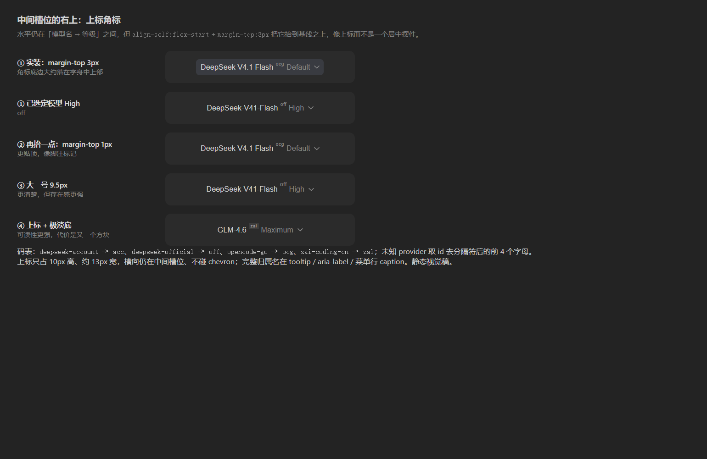

# @local/model-favorites

Composer 模型选择器的 Zed 风格「收藏」增强插件（纯客户端模组）。

## 功能

- **置顶收藏分组（移动语义）**：模型列表顶部固定「收藏 / Favorites」分组，跨 provider 收藏；**已收藏项从原 provider 分组移走，列表里只出现一次**（Zed 式「收藏即上移」），分组为空时整组连表头一起隐藏。收藏分组内按**最近收藏在最上**排序。
- **行内星标**：每个模型行 hover / 键盘聚焦时右侧出现星标，点击切换收藏（`stopPropagation`，不会误选模型，菜单保持打开）；已收藏项在「收藏」分组内常显金色实心星，取消收藏后自动回到原 provider 分组。
- **右侧 provider 小字**：每个模型行右端以 caption 色调显示所属 provider（`DeepSeek 账号` / `DeepSeek` / `zai-coding-cn` …），解决同名模型歧义（如 DeepSeek-V4.1-Flash 同时存在于账号与官方分组），也是「收藏分组」不丢分组上下文的唯一依据。
- **菜单外（触发器）也带归属**：收起菜单后，模型名与推理等级之间的槽位里挂一枚 **≤3 字母的小写 ASCII 上标**（`acc` / `off` / `ocg` / `zai`，8.5px、无边框、`align-self:flex-start; margin-top:3px`），读作 `DeepSeek V4.1 Flashᵒᶜᵍ Default`——**水平在中间槽位、垂直抬到字身上方**，像上标而不是一个居中摆件。迭代结论：①写全名（`DeepSeek V4.1 Flash · opencode-go Default`）多 70–78px 且与模型名重复；②中文在 9px 上下因字面高度 + 字体回退显得比拉丁字母更大，故只用小写 ASCII；③「右上角悬浮（® 式）」试过两个锚点——28px 的按钮里 13px 文字只留 4px 上下余量，8–9px 角标想不压字就必须占掉 chevron 那一格，视觉上像挂在箭头上；④纯居中票签（13px 方框）又太"架在中间"。最终取**中间槽位 + 上标**。完整归属名只进按钮 `title` / `aria-label` 与菜单首页「模型」行的右侧值；**只有存在 ≥2 个 provider 分组时才显示**；未知 provider 取 id 去分隔符后的前 4 个字母（id 恒为 ASCII，不会漏出中文）。

  

  可调项（都只动 `.mfs_triggerProvider`）：抬高到 `margin-top:1px`（更像脚注标记）、放大到 9.5px（`line-height:11px; margin-top:1px`）、或加极淡底 `background:rgba(255,255,255,.08)`。
- **搜索/键盘兼容**：收藏分组作为第一个分组参与模糊搜索过滤、↑/↓ 高亮、Enter/Tab 选中、粘性分组标题。
- **菜单随内容重排**：星标/取消星标会让菜单变高变矮（收藏分组出现、分组被收藏清空、搜索框出现），重排依赖里带上 `filteredGroups`/`showSearch`，内容一变化就在同一次 commit 内把菜单底边重新贴回触发器上方 8px，避免"只往下长、压住输入框"。
- **持久化**：`localStorage` 键 `@local/model-favorites:favorites:v1`（`provider/model` id 数组，写入顺序为收藏先后，展示时倒序 = 最近收藏在上），重启保留、多标签同步。
- **设置页来源标注**：通用设置里的「模型收藏」状态行标题后带「插件」胶囊（`data-plugin-setting="model-favorites-status"`，hover 显示包名），与 DSH 内置行区分。

## 实现原理（重要）

- 内置模型选择器由 `@deepseek-ai/dsh-client-ui-model-selection` 以默认 `priority: 0` 注册到 `conversation.input.model` 单席位插槽；插槽核心按「**最低 priority 渲染**」投影。本插件以 **`priority: -1`** 注册同席位实现无破坏遮蔽——停用/卸载本插件后原版选择器自动回归。
- 组件是内置 `ModelSelect` 的忠实拷贝 + 收藏扩展，数据与动作完全复用内置 `ctx.modelDirectories` 服务（每会话 `ModelDirectory`：目录加载、`select()` 提交、pending、错误 toast、子代理不可用判断全部原生行为）。
- 视觉复用 `@deepseek-ai/dsh-client-ui-primitives`（MenuSurface / MenuGroup / rankByName / observeStickyMenuGroups / 图标），CSS 为内置规则 `mfs_` 前缀重写 + caption/star 扩展。
- 触发按钮、根面板（模型/推理等级）、Effort 面板、`/model` 命令弹窗保持内置行为（弹窗未加收藏，后续可选）。
- **注入面必须与内置 model-selection 对齐**：席位 `inject(sessionId)` 回调会调用 `modelDirectories.directoryFor()`，该调用链内部访问 `remote.session`；Cordis 按「当前注入作用域」校验服务访问，因此插件 `inject` 必须声明 `remote` 与 `remote.session`（否则会话目录首次创建时抛 `cannot get property "remote.session" without inject`）。
- **崩溃退位自愈**：插槽核心对 single/keyed/list 席位实行「崩溃即 abdicate」——条目渲染崩溃一次即永久退位，界面静默回退到内置选择器且不自愈（设置页状态行仍显示「已接管」，因为注册本身仍在账本上）。本插件监听 `ctx.slots.onEntryError`，检测到自己的席位条目（`priority === -1`）被 abdicate 时销毁旧条目并重建新条目（最多 `MAX_SEAT_HEALS = 3` 次，间隔 500ms），控制台打印 `seat entry abdicated, rebuilding`。

## 挂载方式

与其他本地模组一致：

1. `~/.dsh/profiles/desktop/package.json` → `dependencies` 加 `"@local/model-favorites": "link:D:/Users/dsh-local-plugins/model-favorites"`，`dsh.profile.bundles` 加 `"@local/model-favorites"`。
2. Junction：`~/.dsh/profiles/desktop/node_modules/@local/model-favorites` → 本目录。
3. 重启 Harness（或刷新 Web GUI）生效。

## 文件

| 文件 | 职责 |
| :--- | :--- |
| `client.js` | 浏览器半区：收藏存储、样式、`ModelSelect` 拷贝与席位注册 |
| `index.js` | 宿主半区占位（`apply() {}`），仅使 patch 可解析 |
| `cordis.patch.yml` | 插件装载声明（insert entry） |
| `icon.svg` | 插件图标（金星） |

## 已知边界

- 星标仅鼠标可点（`tabIndex: -1`），键盘路径保持内置模型（Enter 选中行）。
- 目录未加载的收藏项会被隐藏，目录恢复后自动重现；收藏 id 永不清理。
- **某 provider 分组被全部收藏**：该分组（含表头）从菜单消失，模型只留在「收藏」分组里，行右端仍有 provider 小字可区分；搜索同样只在「收藏」分组命中，不会重复出现。
- 收藏项在列表中被移走，因此「按 provider 浏览」时看不到已收藏项；若更希望 Zed 之外的「两处都保留」行为，把 `menuGroups` 里的 `withoutFavorites(...)` 换回 `orderedGroups` 即可（一行回退）。
- 星标点击后当前高亮行会随行位移跳到新位置，鼠标稍微移动即自动跟随（键盘路径不受影响）。
- 若内置 `ModelSelect` 大改版，需同步本拷贝（`priority -1` 遮蔽关系不受影响）。
- 席位被 abdicate 时界面**不会**出现任何提示：设置页状态行仍显示「已接管」。若怀疑已退位，看控制台是否有 `seat entry abdicated, rebuilding`；无效则刷新 Web GUI 或重启应用。
- `/model` 命令弹窗与「设置 → 模型」页不在本插件作用域内，那里永远看不到星标与 provider 小字。
- 触发器角标是绝对定位（`.mfs_trigger` 加了 `position:relative`）：不参与布局、不影响行高，所以极窄宽度下仍然是**模型名**先省略；角标只有 8px，若觉得「看不清」就调 `.mfs_triggerProvider` 的 `font-size`（并同步 `line-height` / `max-width`），想彻底不要就删掉渲染处那段 `showProvider && …` 的节点。
