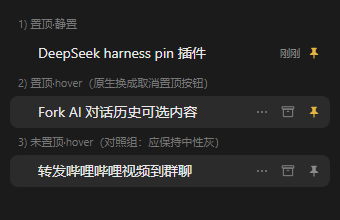
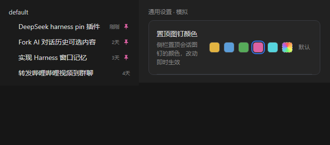
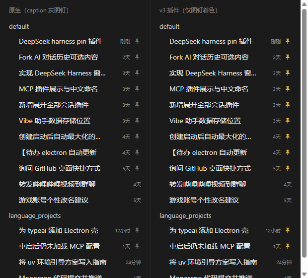

# pin-highlight（`@local/pin-highlight`）

让侧栏「工作区」列表里的**置顶（pin）会话一眼可辨**。

原生 UI 对置顶行的全部处理是：组内排序靠前 + 一枚 caption 灰的小图钉（最暗的文字层级），几乎看不出区别。本插件只做一件事：

- 图钉图标由 caption 灰改为**琥珀色**（置顶的经典色）

行级装饰一概不加——不加左轨、不加底色、不加动效。

### 两个状态都要着色（v4.1）

置顶图钉在 DOM 里其实是**两个不同节点**，只染一个会出现「鼠标移上去颜色变回来」：

| 状态 | 节点 | 处理 |
| :--- | :--- | :--- |
| 静置 | `span.…_pinIndicator`（非交互标记，原生 `display:none` on hover） | 着色 |
| hover / 菜单展开 | `rowActions` 里最右的 `button.…_iconButton`（「取消置顶」，原生隐藏前者后顶替其位置） | **同样着色**，避免悬停瞬时掉色 |

hover 态的按钮用结构选择器定位（`:has(> .pinIndicator)` 限定置顶行 + `rowActions > :last-child`，兼容 Tooltip 是否包一层 wrapper），未置顶行的「置顶」按钮（outline 图标）不受影响。

### 通用设置色盘（v4）

在「通用设置」页新增一行「置顶图钉颜色」（经 `settings.general.item` slot 注册，样式与原生设置行同构）：

- **5 个预设色块**：琥珀（默认）/ 蓝 / 绿 / 玫红 / 青，单击即生效，当前色带 focus 环
- **彩虹自定义块**：点击打开 Chromium 原生色盘（HSV 面板 + 色相条 + 吸管 + HEX 输入）
- **「默认」按钮**：仅在自定义后出现，一键回到主题 warn 色
- 选择持久化到 `localStorage`（`pin-highlight.accent`），启动时自动恢复；改动通过 `<html>` 上的 inline CSS 变量即时生效，无需刷新

### 设计决策（v1 → v4.1，两轮真实使用的收敛）

- **v1**「3px 左条 + 10% 底色」：单分组置顶 9 条连排时饱和成一堵琥珀墙，标记失去逐行语义，底色还与原生 hover/选中底色抢语义通道。
- **v2**「2px 细轨 + 零静置底色」：墙化缓解，但左轨仍被判定为多余装饰。
- **v3**：图钉本身形状独特，着色后的对比已经足够；任何行级装饰都是叠床架屋。唯一的颜色通道=置顶图钉，干净收敛。
- **v4**：加通用设置色盘，颜色可调。
- **v4.1（当前）**：补上 hover 态按钮着色（见上节），消除悬停掉色。

纯 CSS 注入（`<style data-plugin-css>`），零 DOM 改动、零 MutationObserver：

- React 重渲染、原生 hover 换按钮、拖拽排序、归档、搜索结果**全部不受影响**
- 失配时优雅退化为无效果，不会报错

> 验证方式：从 `app.asar` 解包原生 `Rows.module.css`，与插件 CSS 叠加渲染同样的行结构截图比对（含 9 条置顶连排的真实压力场景）。

## 依赖的 DOM 契约（App 更新若改版需回来对照）

| 契约 | 说明 |
| :--- | :--- |
| `div[data-row-key^="session:"]` | 会话行宿主（空白行/归档行同结构，但无图钉） |
| `span[class$="_pinIndicator"]` | 图钉标记单元；CSS module 类名为 `<hash>_pinIndicator`，localName 稳定 |

只有**同时**出现二者的行会被增强；归档行原生不渲染图钉，天然不受影响。

## 改色

**日常路径**：直接在「通用设置 → 置顶图钉颜色」里点色块或用色盘，无需改文件。

手动改默认色（不建议，设置项已覆盖此需求）：`client.js` 里 CSS 的 fallback 链末端的 `#e2b341`。

色相参考（与设置里预设一致）：琥珀 `#e2b341`、蓝 `#5b9dd9`、绿 `#57ab5a`、玫红 `#db61a2`、青 `#56d4dd`。

## 历史样式（已移除，需要时从 git 历史或下述变量找回）

- v1 浓烈版：`box-shadow: inset 3px 0 0 0 var(--dsh-pin-accent);` + `background: color-mix(in srgb, var(--dsh-pin-accent) 10%, transparent);`
- v2 细轨版：`box-shadow: inset 2px 0 0 0 var(--dsh-pin-accent);`（无底色）

## 卸载

1. 删除 `~/.dsh/profiles/desktop/node_modules/@local/pin-highlight` Junction
2. 从 `~/.dsh/profiles/desktop/package.json` 的 `dependencies` 移除 `@local/pin-highlight`
3. 重启 DSH
