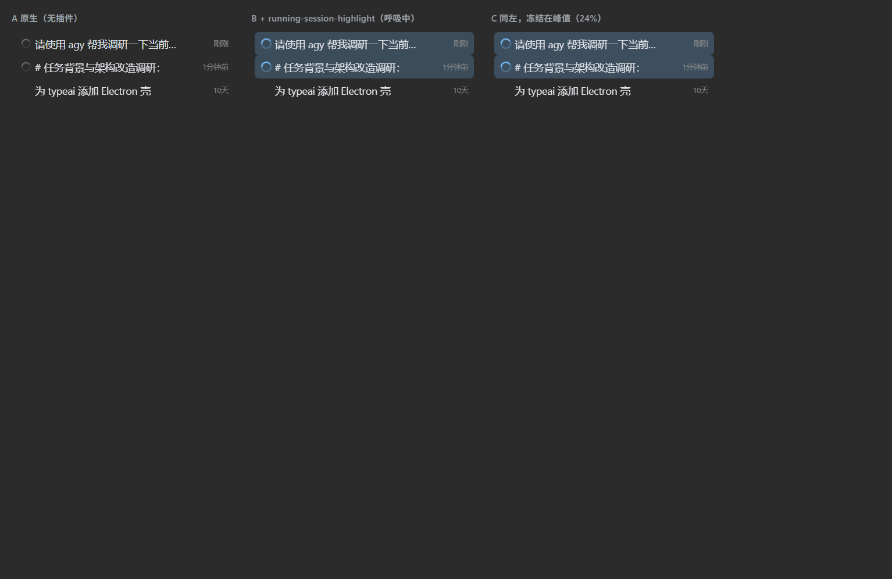

# running-session-highlight（`@local/running-session-highlight`）

让侧栏「正在运行」的会话一眼可辨。

## 为什么需要它（根因，均从 `dsh-client-ui-workspace` / `dsh-client-ui-primitives` 反编译核实）

| 事实 | 出处 |
| :--- | :--- |
| running 时行首槽位渲染宿主自己的状态点，**不**走槽位注入点 | `dsh-client-ui-workspace/lib/client.js:1623`：`showStatus ? <SessionStatusDots/> : renderSlot('sidebar.session.row.leading')` —— 插件拿不到这个位置 |
| 「进行中」文案只写进 `visuallyHidden` | 同文件 `1437-1442`：屏幕阅读器能读，肉眼完全看不到 |
| ongoing 态是 14px SVG 环，颜色取 `--dsw-alias-label-tertiary` | `dsh-client-ui-primitives/lib/StateDot.module.css:37-62` |
| 轨道 `opacity: .25`，弧长 `stroke-dasharray: 12 150` ≈ 圆周 8% | 同上 |
| Rider Dark：tertiary `#858585`、侧栏底 `#2b2b2b` | `rider-theme/client.js:107 / :147` |

结论：轨道合成后约 `#3d3d3d`，弧只剩一抹灰 —— 一条正在跑的会话，视觉上只有一枚几乎看不见的转圈 + 相对时间「刚刚」。这不是配色没调好，是宿主刻意把它压到信息层级最低。

## 做法（纯 CSS 注入，零 DOM 改动、零 MutationObserver）

两条通道一起上：

```css
/* ① 转圈：tertiary 灰 → 主题强调色，加粗 + 放大 */
div[data-row-key^="session:"] svg[data-state="ongoing"] { color: <强调色>; width: 16px; height: 16px; }
div[data-row-key^="session:"] svg[data-state="ongoing"] circle { stroke-width: 2.6; }   /* 2 → 2.6 */
div[data-row-key^="session:"] svg[data-state="ongoing"] circle:first-of-type { opacity: .34; }  /* .25 → .34 */

/* ② 整行：2.6s 呼吸底纹 */
div[data-row-key^="session:"]:has(svg[data-state="ongoing"]) {
  background-color: color-mix(in srgb, <强调色> 16%, transparent);
  animation: rsh-breathe 2.6s ease-in-out infinite;   /* 9% ⇄ 24% */
}
```

### 为什么是这两条

- **不加左条**：会话行的 `border-radius` 会把 `inset` 阴影弯成游离的 `(` 括号 —— 这是 `active-session-highlight` v1 已经踩过并撤掉的坑，本插件不重蹈。
- **只动画 `background-color`**：CSS 动画的优先级高于一切普通声明，所以「运行中」且同时是「当前打开」的行由本插件接管，不会被 `active-session-highlight` 的静态 18% 底纹压掉；两者默认同色，观感连贯。
- **`:has()` 判据来自 DOM 而非类名**：ongoing 态在 DOM 上是 `<svg data-state="ongoing">`，而实心态（done / warning / error / idle）是 `<span data-state=…>`，选择器不会误伤；blank 行与归档行不渲染槽位，天然不受影响。
- **`prefers-reduced-motion: reduce`** 下停掉呼吸，退化为静态 18% 底纹。

### 颜色管线与色盘

```
--dsh-running-accent（本插件自定义）
  > --dsh-active-row-accent（active-session-highlight 的自定义色）
  > --dsw-alias-state-business-primary（主题 business 色）
  > #4176e6
```

默认与「当前会话高亮」同色；改任一侧都各自即时生效。在「通用设置」页新增一行「运行中会话高亮颜色」（`settings.general.item` slot，`order: 15`，紧邻 pin-highlight 的 13 与 active-session-highlight 的 14）：

- **5 个预设色块**（与 pin-highlight / active-session-highlight 同一套色值）：蓝 `#5b9dd9` / 琥珀 `#e2b341` / 绿 `#57ab5a` / 玫红 `#db61a2` / 青 `#56d4dd`
- **彩虹自定义块**：Chromium 原生色盘（HSV 面板 + 色相条 + 吸管 + HEX）
- **「默认」按钮**：仅在自定义后出现，一键回到主题 business 色
- 选择持久化到 `localStorage`（`running-session-highlight.accent`），启动自动恢复；改动通过 `<html>` 内联 `--dsh-running-accent` 即时生效，无需刷新
- 行标题后带「插件」胶囊（`data-plugin-setting="running-session-highlight"`，hover 显示包名），与 DSH 内置设置行区分

## 与两个兄弟插件的关系

| 插件 | 管的行 | 通道 |
| :--- | :--- | :--- |
| `pin-highlight` | 置顶行 | 图钉着色（`.php_*`） |
| `active-session-highlight` | **当前打开**行（`aria-selected="true"`） | 静态 18% 底纹（`.ash_*`） |
| `running-session-highlight`（本插件） | **正在运行**行（行内含 ongoing 状态点） | 呼吸底纹 + 转圈着色（`.rsh_*`） |

三者互不覆盖：置顶 + 运行中 + 当前打开可以同时成立，三种装饰各占一条语义通道。

## 依赖的 DOM 契约（App 更新若改版需回来对照）

| 契约 | 出处 | 说明 |
| :--- | :--- | :--- |
| `div[data-row-key^="session:"]` | `Rows.module.css` / `SessionNodeItem` | 会话行宿主 |
| `svg[data-state="ongoing"]` | `StateDot`（primitives） | 运行中状态点：`node.running` 为真，或本会话有子 agent 在跑 |

两条同时成立才会被增强；任一失效即静默退化为无效果，不报错。

## 验证方式

1. **静态**：`node --check client.js`；再以桩 `window.__ModuleLoader__` 执行 `client.js`，断言 `__test.CSS` 含 `:has(svg[data-state="ongoing"])`、`color-mix`、`@keyframes rsh-breathe`、`stroke-width: 2.6`、`width: 16px`，且**不含** `box-shadow` / `inset` 阴影 / `--dsw-alias-interactive-bg-hover`。
2. **契约复核**：从安装包解包 `dsh-client-ui-workspace/lib/client.js:1623`、`dsh-client-ui-primitives/lib/StateDot.module.css:37-62`，确认上述两条契约仍在。
3. **渲染对照**：用宿主真实 `Rows` CSS 与 `StateDot.module.css` + 本插件真实 CSS 重建三栏（原生 / 插件动态 / 冻结峰值），见下图 —— 左为原生（转圈灰暗、行无底纹），右为插件（转圈亮蓝加粗、整行底纹）。



4. **运行期**：刷新页面后确认 —— 运行中的会话行转圈变强调色且明显变粗变大、底纹缓慢呼吸；非运行行完全不受影响；通用设置里色盘选色即时生效且重启保持；`prefers-reduced-motion` 下不再呼吸。

## 卸载

1. 删除 `~/.dsh/profiles/<profile>/node_modules/@local/running-session-highlight` 链接
2. 从同目录 `package.json` 的 `dependencies` 移除 `@local/running-session-highlight`
3. 从同文件 `dsh.profile.bundles` 移除 `@local/running-session-highlight`（**只删依赖不删 bundles 项会在启动时解析失败**）
4. 刷新 / 重启 DSH
