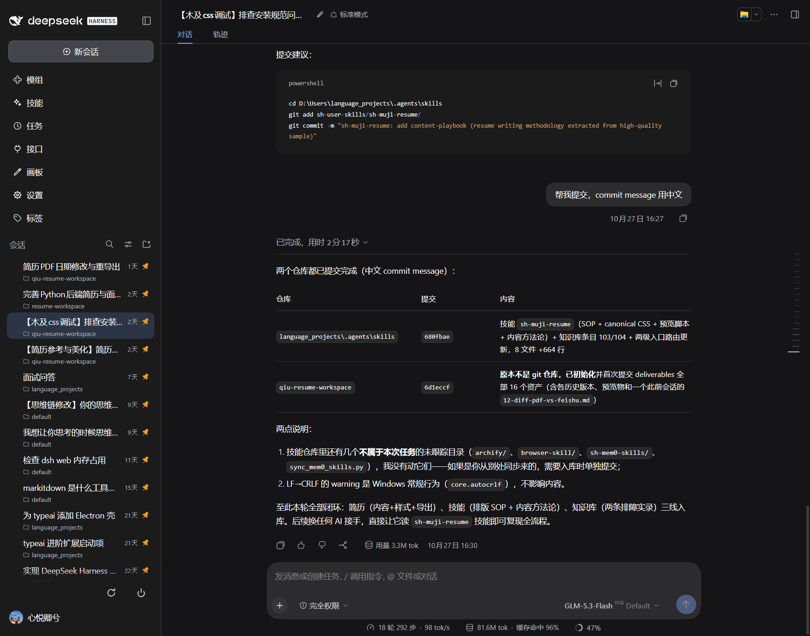
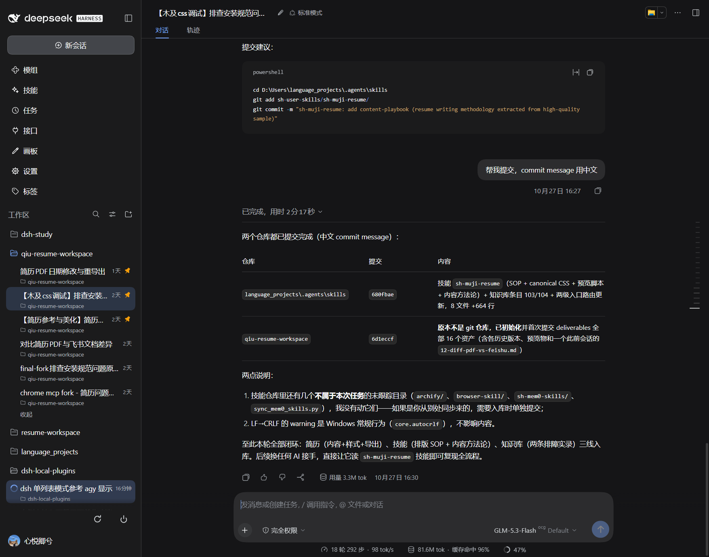
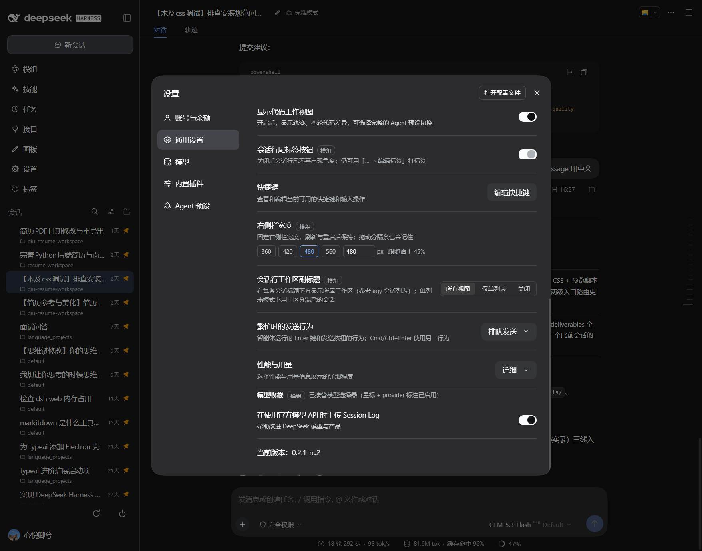

# `@local/session-workspace-label`

侧栏会话行的**工作区副标题**：在每条会话标题下方补一行灰色小字（文件夹图标 + 工作区名），
参考 agy（Antigravity）会话列表的样式。

解决的问题：DSH 默认「按工作区」分组时工作区名在组头上，一旦切到**单列表**，不同工作区的
会话混成一片，只能靠标题猜归属。本插件让两种视图都能一眼看到工作区。

```
┌──────────────────────────────────────┐
│ 简历 PDF 日期修改与重导出       1天 ★ │
│ ▸ qiu-resume-workspace               │
└──────────────────────────────────────┘
```



按工作区分组时同样显示（组内每行重复工作区名，嫌啰嗦可切到「仅单列表」）：



设置行：



## 行为

| 项 | 说明 |
| :--- | :--- |
| 显示位置 | 会话行标题下方，与标题左缘对齐（8px padding + 16px 状态格 + 4px 标题间距） |
| 行高 | 32px → 46px（标题内容区仍是 32px，下方留 14px 给副标题） |
| 名称来源 | Workspace 的用户可改标题 → 会话 `cwd` 的 basename → `未分组` |
| 图标 | 11px 轮廓文件夹，`currentColor`，跟随主题 |
| 交互 | `pointer-events: none`：不挡点击、拖拽、hover 卡片、行尾按钮 |
| 搜索 | 搜索结果行（`searchResultRow`）不受影响 |

## 设置

「设置 → 通用设置 → 会话行工作区副标题」三选一，存 `localStorage`（`session-workspace-label.mode`）：

| 值 | 含义 |
| :--- | :--- |
| `flat`（默认） | **仅单列表视图显示**；分组视图不显示（组头已有工作区名，避免重复） |
| `all` | 所有视图都显示（按工作区 / 按工作区树 / 单列表） |
| `off` | 关闭 |

默认只服务单列表：分组模式下每行重复组头的名字没有信息增量，所以不显示。想在所有视图都看到
（比如滚动时组头移出视口）再切到「所有视图」。

## 实现方式（为什么是 DOM 注入）

宿主 `@deepseek-ai/dsh-client-ui-workspace` 的会话行是一个 32px 的 `treeitem`：

```html
<div data-row-key="session:<id>" class="…_sessionRow">
  <span class="…_slot"></span>       <!-- 状态点 / sidebar.session.row.leading -->
  <span class="…_title"></span>
  <span class="…_time"></span>
  <span class="…_pinIndicator"></span> <!-- 仅置顶行 -->
  <span class="…_rowActions"></span>
</div>
```

宿主没有开放「行副标题」座位：`sidebar.session.row.leading` 只有 16px 且在有状态点时**不渲染**；
`sidebar.session.row.hover` 只在 hover 卡片里；整块 shadow `sidebar.workspaces` 则要复刻搜索、
菜单、拖拽、归档对话框、工作区增删改——代价远超收益。

所以插件只做两件事：

1. 注入一段样式，把带 `data-swl` 的行抬高 14px；
2. 在宿主行节点**末尾追加**一个装饰性 `span.swl_label`。

React 的 reconciliation 只按 index 管理它自己的子节点，末尾追加的节点不会被清掉（实测：点击
切会话、切视图、时间刷新后 102/102 保留）。行被重建（切换分组方式、筛选归档）时由
`MutationObserver` 补回——先比对再写，不会自喂循环。

数据走两个只读快照源（**不 retain、不激活 Session**）：

- `ctx.get('sessions').list` → `{ byId }`，取 `cwd` 兜底；
- `ctx.get('workspaces').list` → `{ items }`，取 `title` / `path` / `sessionIds`。

`inject` 必须声明 `sessions` 与 `workspaces`：cordis 的 `ctx.get(name)` 对未 inject 的服务
返回 `undefined`（不是抛错），漏写就会静默不工作——这是实测踩到的坑。

## 兼容与边界

- 只认宿主自己的行：行里必须有一个 `class$="_title"` 的直接子 `span`，否则跳过（比如
  被其它插件整块接管后的行结构不同，不会被误改）。
- 行高变化后 `AnimatedRows` 的 FLIP 动画按实际 `getBoundingClientRect()` 计算，不受影响。
- 窄栏（rail）不渲染列表，无影响。
- 空白会话（新会话）同样有副标题；已归档行按原样置灰。

## 文件

| 文件 | 职责 |
| :--- | :--- |
| `client.js` | 全部逻辑：样式、数据映射、DOM 同步、设置行 |
| `index.js` | Host 半区空壳（bundle 能解析即可） |
| `cordis.patch.yml` | profile patch 注入行 |
| `self-test.mjs` | 零依赖纯函数用例（`node self-test.mjs`） |

## 验证记录（2026-10-30，web profile）

- 默认（`flat`）单列表：102 行全部标注，行高 46px，工作区名与 `~/.dsh/storages/workspace.json` 一致。
- 切到「按工作区」：25 行 **0 标注**、`data-swl` 清零、行高自动还原 32px；切回单列表恢复 102 标注。
- 设置行出现在「设置 → 通用设置」，徽章显示「模组」（`mod-renamer` 生效时的预期结果）。
- 刷新、切视图、点会话后副标题均保留，无控制台报错。
