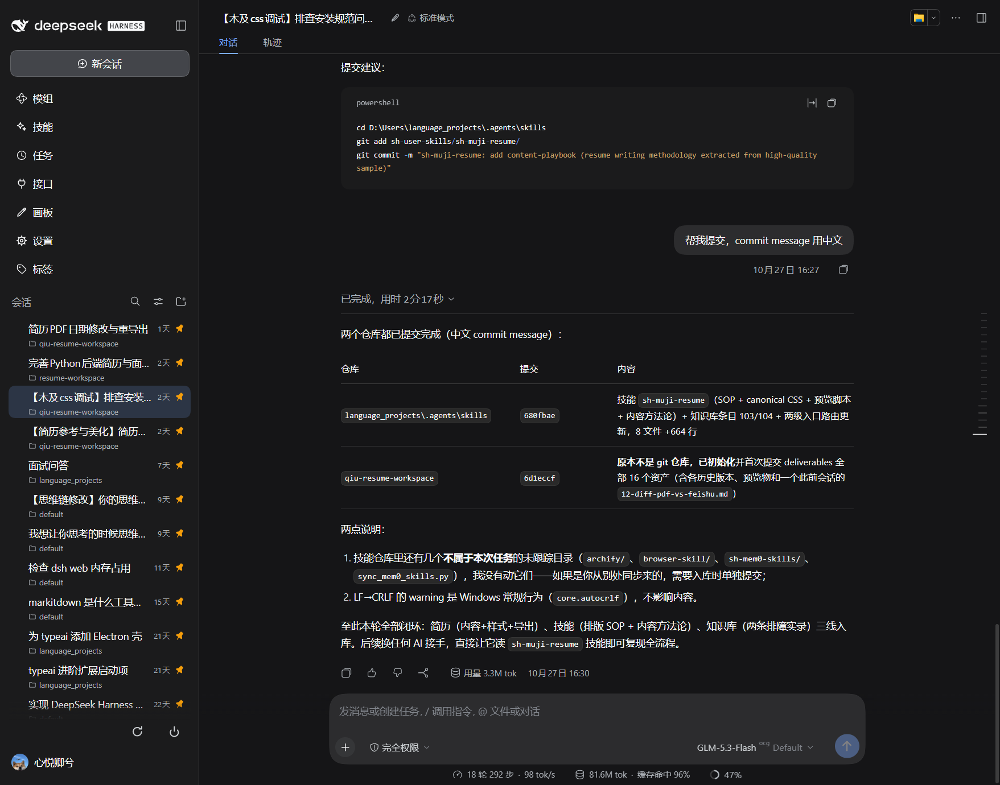
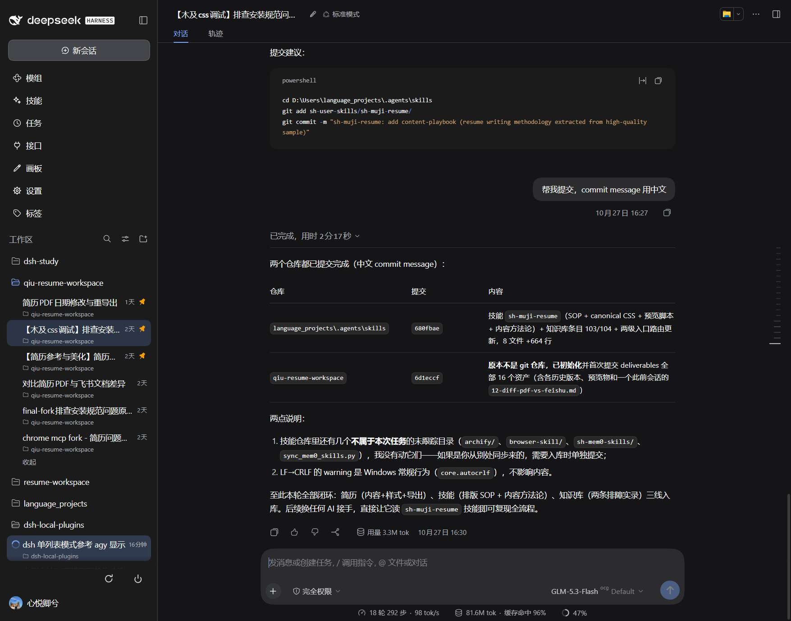
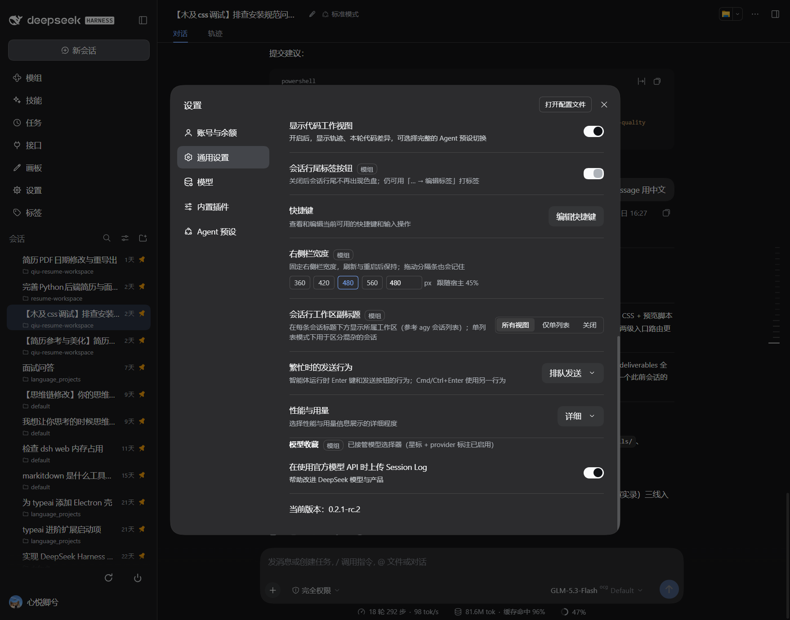
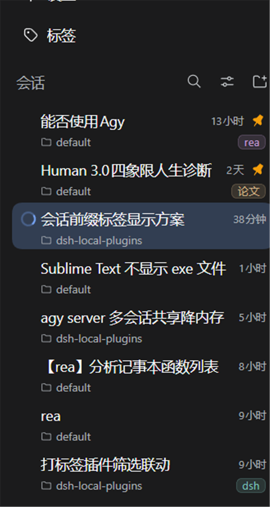

# `@local/session-workspace-label`

侧栏会话行的**工作区副标题**：在每条会话标题下方补一行灰色小字（文件夹图标 + 工作区名），
参考 agy（Antigravity）会话列表的样式。

v1.1 起这一行右侧还能挂一个**会话标识**（短代号），用来替代手工写在标题前的 `【rea】`，
见下文「会话标识」。

解决的问题：DSH 默认「按工作区」分组时工作区名在组头上，一旦切到**单列表**，不同工作区的
会话混成一片，只能靠标题猜归属。本插件让两种视图都能一眼看到工作区。

```
┌──────────────────────────────────────┐
│ 简历 PDF 日期修改与重导出       1天 ★ │
│ ▸ qiu-resume-workspace               │
└──────────────────────────────────────┘
```



按工作区分组时同样显示（组内每行重复工作区名，嫌啰嗦可切到「仅单列表」）：



设置行：



## 行为

| 项 | 说明 |
| :--- | :--- |
| 显示位置 | 会话行标题下方，与标题左缘对齐（8px padding + 16px 状态格 + 4px 标题间距） |
| 行高 | 32px → 46px（标题内容区仍是 32px，下方留 14px 给副标题） |
| 名称来源 | Workspace 的用户可改标题 → 会话 `cwd` 的 basename → `未分组` |
| 图标 | 11px 轮廓文件夹，`currentColor`，跟随主题 |
| 交互 | `pointer-events: none`：不挡点击、拖拽、hover 卡片、行尾按钮 |
| 搜索 | 搜索结果行（`searchResultRow`）不受影响 |
| 会话标识 | 可选，右侧胶囊，见下节；不影响行高 |

## 设置

「设置 → 通用设置 → 会话行工作区副标题」三选一，存 `localStorage`（`session-workspace-label.mode`）：

| 值 | 含义 |
| :--- | :--- |
| `flat`（默认） | **仅单列表视图显示**；分组视图不显示（组头已有工作区名，避免重复） |
| `all` | 所有视图都显示（按工作区 / 按工作区树 / 单列表） |
| `off` | 关闭 |

默认只服务单列表：分组模式下每行重复组头的名字没有信息增量，所以不显示。想在所有视图都看到
（比如滚动时组头移出视口）再切到「所有视图」。

## 会话标识（v1.1）

给会话起一个短代号，显示在副标题行右侧，**不改会话标题**。

```
能否使用Agy                     13小时
📁 default                      [rea]
```



| 项 | 说明 |
| :--- | :--- |
| 入口① | **hover 会话行**：副标题右端浮出一个淡「+」，点它直接开编辑器（主入口，不用进菜单） |
| 入口② | 点**已有胶囊**：直接开编辑器改 / 清 |
| 入口③ | 会话行 `…` 菜单 →「设置会话标识」（排在「分叉会话」之后、「编辑标签」之前） |
| 输入 | Enter 保存、Esc 关闭；首尾空白和包裹用的 `【】[]（）` 会被剥掉，截断到 12 字符 |
| 候选 | 用过的代号自动进池（最多 24 个），下次点一下即用，避免 `rea` / `REA` 分裂 |
| 清除 | 浮层里「清除」，或保存空串；代号池保留历史值 |
| 样式 | 10.5px 胶囊 + 按代号哈希取色（与 session-tag-lite 同一色环），右缘对齐 8px 内边距 |
| 显示 | 跟随副标题：`flat` 仅单列表、`all` 所有视图、`off` 全关 |

> 「+」只在行 hover 时出现，且用 CSS 伪元素绘制——它不会进入无障碍名称，也不会挡住点击会话
> （点它时在捕获阶段 `stopPropagation`，不会顺带选中/打开会话）。

### 为什么不做成标题前缀

手工 `【rea】` 写进标题后，改的是会话的 title：搜索词、导出文本、`…` 菜单文案都会带上它，而且每开
一个会话都要记得敲一次。标识是独立的一份 `sessionId → 代号` 映射，改、清、复用都不碰标题。

### 存储

`localStorage['session-workspace-label.aliases.v1']` 只是首屏镜像；权威数据由 Host 半区落到
`$DSH_HOME/session-workspace-label/state.json`（临时文件 + rename 原子替换）：

| 请求 | 行为 |
| :--- | :--- |
| `GET /plugins/session-workspace-label/state` | `{ ok, revision, data }`，没有数据时 `data: null` |
| `PUT /plugins/session-workspace-label/state` | body `{ data }`，写盘后返回新 revision |

两条都要带 `x-session-workspace-label: 1` 头、只接受同源 Origin。启动时**本地为空、远端有数据**才恢复；
本地有数据则反向覆盖远端，避免另一个浏览器的空状态把本机标识抹掉。路由缺失（桌面构建，或改了
`index.js` 还没重启 `dsh web`）时静默退回 localStorage 单机模式。

### 边界

- **宿主左栏搜索框搜不到代号**：搜索框由 `ui-workspace` 内部持有、没有注册点，标识又不写进标题。
  按代号找会话请用 session-tag-lite 的标签面板，或把代号同步成那边的标签。
- 分组视图下副标题整体不显示，标识也就一起不显示（跟随 `flat` 语义）。
- 会话删除后它的标识留在 `state.json` 里（没有渲染成本，也不会串到别的会话），不做孤儿清理。
- 代号是单值：一条会话只有一个标识；多标签整理仍交给 session-tag-lite。

## 标题前缀迁移（v1.2）

手工写在标题前的 `【rea】` 不该靠插件「猜」或偷偷改写渲染。这里给的是一次**真改名**的迁移：

- 入口：设置 → 通用设置 →「会话行工作区副标题」→ **迁移标题前缀…**
- 扫描所有以 `【xx】` 开头且有正文的会话，列出 `【前缀】 正文`，默认勾选项目类；
  `待办 / 完成 / 进行中 / 暂停 / 归档 / 存档 / 草稿 / todo / done / wip` 这类状态词默认不勾
  （`【待办 electron】` 这种复合前缀只看第一个词，同样默认不勾）
- 执行 = 逐条 `rename` 去掉前缀 + 把前缀写成标识；**原标题备份在本地，可撤销**
- 撤销 = 按备份把标题改回去，并删掉对应的标识

### 为什么不做「渲染时隐藏前缀」

你最初设想的是「读标题前缀 → 隐藏 → 显示到副标题行」。技术上能做，但只在侧栏生效：

| 问题 | 后果 |
| :--- | :--- |
| 标题真实值不变 | `…` 菜单、复制、导出、搜索框、悬停提示里仍是带前缀的版本 |
| 要和 React 抢文本节点 | 切会话、重命名、虚拟列表重建时被还原，得反复补，闪一下是常事 |
| 与 `session-title-edit` 打架 | 它的内联编辑用 `visibility:hidden` 藏标题再叠输入框，文本被改会错位 |

真改名一次性解决，之后所有入口都干净，标识还能单独改。

### 局限

- 只认全角 `【】`：半角 `[]` 在 Markdown / 代码标题里太常见，误伤率高。
- 只迁移「有正文」的标题（单独一个 `【rea】` 不进候选）。
- 撤销只覆盖备份里还在的会话；迁移后被删掉的会话会记为失败。

## 实现方式（为什么是 DOM 注入）

宿主 `@deepseek-ai/dsh-client-ui-workspace` 的会话行是一个 32px 的 `treeitem`：

```html
<div data-row-key="session:<id>" class="…_sessionRow">
  <span class="…_slot"></span>       <!-- 状态点 / sidebar.session.row.leading -->
  <span class="…_title"></span>
  <span class="…_time"></span>
  <span class="…_pinIndicator"></span> <!-- 仅置顶行 -->
  <span class="…_rowActions"></span>
</div>
```

宿主没有开放「行副标题」座位：`sidebar.session.row.leading` 只有 16px 且在有状态点时**不渲染**；
`sidebar.session.row.hover` 只在 hover 卡片里；整块 shadow `sidebar.workspaces` 则要复刻搜索、
菜单、拖拽、归档对话框、工作区增删改——代价远超收益。

所以插件只做三件事：

1. 注入一段样式，把带 `data-swl` 的行抬高 14px；
2. 在宿主行节点**末尾追加**一个装饰性 `span.swl_label`（文件夹图标 + 工作区名）；
3. 在这个 `span` 里再放一个 `span.swl_alias`（会话标识；没有标识时 `display:none`）。

React 的 reconciliation 只按 index 管理它自己的子节点，末尾追加的节点不会被清掉（实测：点击
切会话、切视图、时间刷新后 102/102 保留）。行被重建（切换分组方式、筛选归档）时由
`MutationObserver` 补回——先比对再写，不会自喂循环。

数据走两个只读快照源（**不 retain、不激活 Session**）：

- `ctx.get('sessions').list` → `{ byId }`，取 `cwd` 兜底；
- `ctx.get('workspaces').list` → `{ items }`，取 `title` / `path` / `sessionIds`。

`inject` 必须声明 `sessions` 与 `workspaces`：cordis 的 `ctx.get(name)` 对未 inject 的服务
返回 `undefined`（不是抛错），漏写就会静默不工作——这是实测踩到的坑。

## 兼容与边界

- 只认宿主自己的行：行里必须有一个 `class$="_title"` 的直接子 `span`，否则跳过（比如
  被其它插件整块接管后的行结构不同，不会被误改）。
- 行高变化后 `AnimatedRows` 的 FLIP 动画按实际 `getBoundingClientRect()` 计算，不受影响。
- 窄栏（rail）不渲染列表，无影响。
- 空白会话（新会话）同样有副标题；已归档行按原样置灰。

## 文件

| 文件 | 职责 |
| :--- | :--- |
| `client.js` | 全部渲染逻辑：样式、数据映射、DOM 同步、标识菜单与浮层、设置行 |
| `index.js` | Host 半区：`state` 路由 + `$DSH_HOME/session-workspace-label/state.json` 落盘 |
| `cordis.patch.yml` | profile patch 注入行 |
| `self-test.mjs` | 零依赖纯函数用例（`node self-test.mjs`） |
| `alias.png` | 会话标识效果图 |

> 改过 `index.js`（Host 半区）后要重启一次 `dsh web` 才会挂上 `state` 路由；只改 `client.js` 刷新页面即可。

## 验证记录（2026-10-30，web profile）

- 默认（`flat`）单列表：102 行全部标注，行高 46px，工作区名与 `~/.dsh/storages/workspace.json` 一致。
- 切到「按工作区」：25 行 **0 标注**、`data-swl` 清零、行高自动还原 32px；切回单列表恢复 102 标注。
- 设置行出现在「设置 → 通用设置」，徽章显示「模组」（`mod-renamer` 生效时的预期结果）。
- 刷新、切视图、点会话后副标题均保留，无控制台报错。

## 验证记录（2026-11-01，会话标识）

- 菜单项出现在「分叉会话」之后、「编辑标签」之前；点击后菜单关闭并弹出浮层。
- 浮层自动聚焦输入框、预填当前代号；候选池按最近使用排序；Esc / 点遮罩关闭。
- 保存后胶囊即时出现（`dsh-dev` 走池内新色）；刷新后仍在；「清除」后即时消失且 `aliases` 里的键被删掉。
- 胶囊右缘与标题行时间列同为 8px 内边距；工作区名过长时先被压缩、胶囊不被挤掉。
- Host 路由单测（临时 `DSH_HOME`）：GET 空库 `data:null`、PUT 后 revision+1、读回一致、缺 guard 头 403、
  坏 JSON 400、落盘文件为 `{ revision, data }`。
- `node self-test.mjs` 74 项通过；`node tools\verify-plugin-locale.mjs` 264 项全绿。

## 验证记录（2026-11-03，入口前移）

反馈「好像不太行」后复查：链路本身是通的（菜单项在、浮层能开、`state.json` 能写、刷新保持），
问题在**入口藏得太深**——必须先 hover、再点 `…`、再从 9 个菜单项里找。于是把主入口搬到副标题行本身：

- hover 行 → 右端出现淡「+」（空态胶囊，`width:16px`、`opacity:.7`、`pointer-events:auto`）；
- 点「+」或点已有胶囊 → 直接开编辑器，捕获阶段 `stopPropagation`，实测 `aria-selected` 仍为 `false`；
- 空态「+」是 `::after` 伪元素，不进宿主 treeitem 的无障碍名称。

实测：点空态「+」→ 浮层带上正确会话标题 → 输入 `qb` 保存 → 胶囊即时出现并推到 Host（revision 递增）。
测试写入的标识已从本地与 `state.json` 一并清空（远端 `aliases: {}`）。
